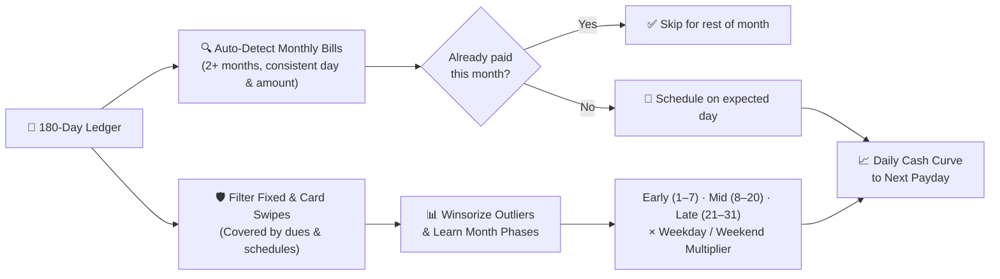

<div align="center">


# SpendWiser

**Your bank app shows what’s left. SpendWiser shows what happens next.**

A local-first, India-native **Financial OS** built in Flutter — combining a phase-aware Cash Runway engine, 2-second capture (text, voice, receipt OCR, bank SMS), credit card & EMI intelligence, and a smoked-glass Command Orb UI.


</div>

---

## ⚡ Why It Hits Different

Most finance apps are glorified spreadsheets that judge you *after* you're broke. SpendWiser is built around **forward signal**:

- **🧠 Smart Cash Runway** — Knows rent & bills hit on the 1st–5th and refuses to extrapolate start-of-month spikes into a fake month-end crash.
- **🎙️ 2-Second Capture** — Type `"chai 40"` or `"uber 280"`, speak it, snap a receipt, or parse bank SMS alerts automatically.
- **🇮🇳 India-Native DNA** — Built for UPI velocity, HDFC/ICICI/SBI/Axis/Kotak/Amex SMS formats, Indian card billing cycles, and ₹ lakh/crore formatting.
- **🛸 Command Orb + Customizable Nav** — Navigate via a tactile radial **Command Orb** & Bento launcher, or switch to a **customizable Nav Bar** (up to 3 left + Apps + 3 right).
- **🔒 Zero Bank Credentials** — Local-first storage with Hive, biometric/PIN lock, full PDF/XLSX/JSON export, and optional Firebase sync.

---

## 🧠 Cash Runway: The Brain Under the Hood

A naive `totalSpend / 90` average breaks the moment you pay ₹35,000 in rent and bills at the start of the month. SpendWiser’s `FinanceCalculator.cashRunway` models your actual monthly rhythm:



- **Auto-detects unregistered bills** (maid, broadband, maintenance, etc.) from transaction history and skips them once paid for the month.
- **Separates month phases** so early-month spending never pollutes mid/late-month daily burn.
- **Winsorizes one-off spikes** (flights, gadgets, emergencies) so a single purchase doesn't wreck your forecast.

---

## ⚡ Capture Without Friction

| Input | Powered By | Example |
|---|---|---|
| **Quick Type** | `CaptureParser` | `"chai 40"`, `"zomato 340"`, `"salary 142000"` |
| **Voice** | `speech_to_text` | Speak natural amounts & merchant names |
| **Receipt OCR** | `google_mlkit_text_recognition` | Snap a bill → extracts items, merchant & total |
| **Bank SMS** | `BankSmsParser` | Parses HDFC, ICICI, Axis, SBI, Kotak, Amex & UPI alerts (ignores OTPs & promos) |

Merchants are auto-categorized across **Indian & global brands** (Swiggy, Zomato, Blinkit, Zepto, BigBasket, BookMyShow, Uber, Ola, Rapido, IRCTC, Jio, Airtel, Amazon, Flipkart, YouTube, Netflix, Spotify, and more) with **real brand icons** via `simple_icons` + crisp vector fallbacks.

---

## 🎛️ The Financial OS Modules

| Module | What It Actually Does |
|---|---|
| **Home** | Net Worth hero card, Cash Runway curve, Safe-to-Spend, Financial Health Score & upcoming bills |
| **Ledger** | Day-grouped transaction archive + calendar view, search, tags, and instant edits |
| **Banks** | Savings, cash, and liquid account balances in one place |
| **Cards** | Statement cycles, utilization, minimum vs. total due, cardholder details & due countdowns |
| **Debt** | Loan tracking, EMI calendar, full amortization schedules & **Avalanche vs. Snowball** payoff simulator |
| **Budgets** | Category envelopes + total monthly pace without guilt-trip UI |
| **Goals** | Target amounts, deadlines, progress tracking & contributions |
| **Subscriptions** | Active renewals, recurring schedules & monthly burn visibility |
| **Split** | Shared expenses with friends/roommates, balances & clean settlements |
| **Insights** | Monthly spending breakdowns, top merchants & **Ask SpendWiser** |
| **Tools & Export** | Annual summary **PDF**, statement **Excel (`.xlsx`)**, JSON backup/restore & PIN/biometric lock |

---

## 🏗️ Tech Stack & Architecture

```text
lib/
├── core/          # Theme tokens, Instrument Serif + DM Sans typography, brand icons, shared widgets
├── data/
│   ├── models/    # Account, Card, Loan, Transaction, Subscription, Goal, Split, Snapshot
│   ├── services/  # FinanceCalculator (Runway, Health, Amortization, Payoff), PDF/XLSX/Backup
│   ├── sms/       # BankSmsParser (Indian banks + UPI + OTP/promo filtering)
│   └── mock/      # Seeded prototype store
└── features/      # Home, Ledger, Cards, Debt, Budgets, Goals, Split, Subscriptions, Insights, Settings, Launcher
```

| Layer | Packages |
|---|---|
| **State & UI** | `flutter_riverpod`, `animations`, `flutter_svg`, `simple_icons`, `intl` |
| **Local Storage** | `hive`, `hive_flutter`, `path_provider` |
| **Capture & Intelligence** | `speech_to_text`, `image_picker`, `google_mlkit_text_recognition` |
| **Security & Alerts** | `local_auth`, `crypto`, `flutter_local_notifications`, `timezone` |
| **Exports & Sync** | `pdf`, `excel`, `share_plus`, `file_picker`, `firebase_core`, `firebase_auth`, `cloud_firestore`, `google_sign_in` |

---

## 🚀 Run It Locally

```bash
# 1. Install dependencies
flutter pub get

# 2. Run on a connected device or emulator
flutter run

# 3. Verify static analysis & test suite
flutter analyze
flutter test
```

---

## 🔒 Privacy Stance

1. **No ads. No data brokers.**
2. **No bank logins or scraping credentials.**
3. **Local-first by default** — your ledger works offline on-device.
4. **Your data leaves when you say so** — export to PDF/XLSX/JSON or delete everything anytime.

---

<div align="center">

**Built for people who want clarity, not a second job as an accountant.**

<br />

<sub>DESIGNED & BUILT BY</sub>

### [Hariharen](https://hariharen.space)

[](https://hariharen.space)

</div>
